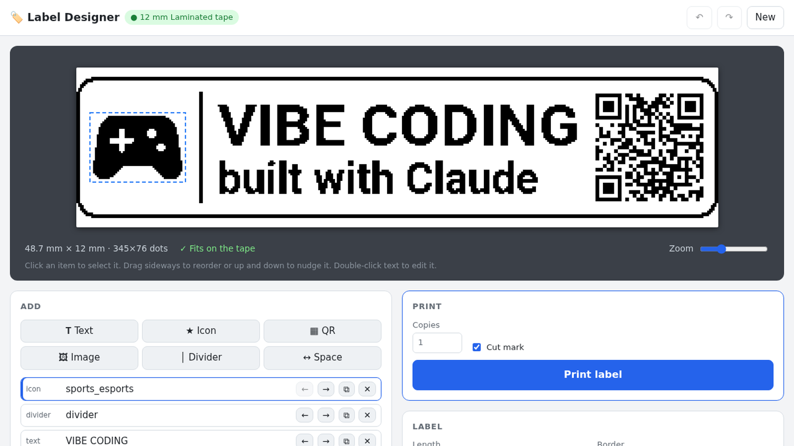

# Label Print Portal



Web portal for a **Brother P-touch PT-1230PC** label printer, driven from a
Raspberry Pi Zero W.

- Flask app on port **5050**.
- **`/` is a WYSIWYG label designer.** The browser renders the label as a 1-bit bitmap at
  the tape's exact dot height (76 dots for 12mm at 180dpi), so the preview is exactly what prints.
  - Items flow left to right: multi-line text (auto-fits to the tape height, first-line scale, 7 fonts,
    bold/italic/white-on-black), Material icons, QR codes (with a Wi-Fi helper), images (threshold/dither),
    dividers and spacers. Drag sideways to reorder, drag up/down to nudge.
  - Label options: fit-to-content or fixed length in mm, border styles, invert, margins. Copies and cut mark.
  - Warns when text doesn't fit or gets too small to read. Supports undo/redo.
  - Templates, saved designs and a history of printed labels (stored in `designs.json` on the Pi).
  - Fonts, icon font and QR library are served from `static/`, so it works without internet.
- `/simple` is the original text/image form.
- API: `GET /api/tape`, `POST /api/print` (PNG + copies + cutmark), `GET/POST /api/designs`, `DELETE /api/designs/<saved|history>/<id>`.
- Prints by shelling out to [`ptouch-print`](https://github.com/tomaszdd/ptouch-print)
  (fork of `git.familie-radermacher.ch/linux/ptouch-print`), installed at `/usr/local/bin/ptouch-print`.
- Images are resized to the loaded tape's live max print height (from `ptouch-print --info`)
  and dithered to 1-bit, because ptouch-print does not scale images.


## Layout on the Pi

| Path | Purpose |
|---|---|
| `/home/pi/label-portal/app.py` | Flask app |
| `/home/pi/label-portal/static/` | designer page, JS, CSS, fonts, QR lib |
| `/home/pi/label-portal/designs.json` | saved and printed designs (not in git) |
| `/home/pi/label-portal/usb_watch.sh` | logs printer USB connect/disconnect to `usb_events.log` |
| `/home/pi/label-portal/venv` | Python venv (`requirements.txt`) |
| `systemd/label-portal.service` | runs the app |
| `systemd/usb-watch.service` | runs the USB logger |

## Install

```sh
# ptouch-print (needs cmake, gettext, libgd-dev, libusb-1.0-0-dev)
git clone https://github.com/tomaszdd/ptouch-print.git && cd ptouch-print && ./compile.sh
sudo install build/ptouch-print /usr/local/bin/

# portal
python3 -m venv venv
venv/bin/pip install --upgrade pip      # Bullseye's stock pip fails silently on Flask
venv/bin/pip install -r requirements.txt
sudo cp systemd/*.service /etc/systemd/system/
sudo systemctl enable --now label-portal usb-watch
```

## Gotchas

- `ptouch-print` exiting 0 is **not** proof of a print. Check `ptouch-print --info`
  (`media type`, `error`) and the tape itself.
- Most "garbage / no output" issues were a **backwards TZe cassette** or a slack ink
  ribbon, not software.
- The printer's E/EL switch must be on **E** for USB printing.
- Verified on mains power 2026-10-02 (previously batteries).
